Dimensions (block_dimensions)
=============================

Your learning path, one glance away.

A block that turns a learner's learning plans into cards: **plan cards** with a trail of the
plan's competencies, and **competency cards** that lead straight to each competency's courses.
Cards carry the covers, colours, tags and display modes managed in
[Competency Dimensions](https://github.com/uaiblaine/moodle-local_dimensions) (`local_dimensions`),
and each section has a filter line of its own: status, search, favourites and filter chips.

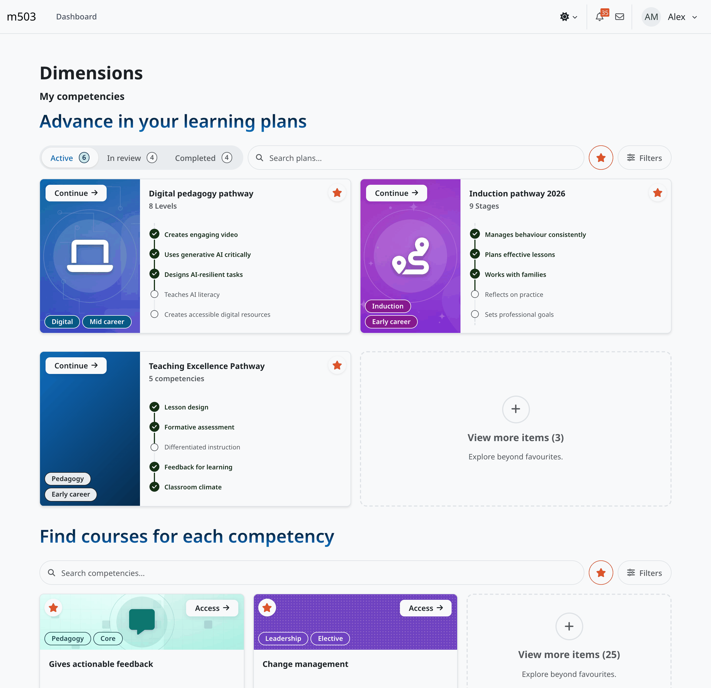

Moodle gives every learner a learning plan, but no fast way back into it: plans sit several clicks
deep in the profile, and the Dashboard, the page learners actually open every session, says
nothing about them. This block is that front door. It answers three questions the moment the page
loads: *where am I* (the trail on each plan card), *what's next* (the Continue or Access button,
which lands on the right view), and *what matters to me* (the favourites each learner keeps).

It follows its companion's philosophy: no tables of its own, core subsystems wherever one exists
(favourites, web services, caching), and a thin presentation layer over what Moodle already knows.

- **Plan cards and competency cards**, with covers and colours from `local_dimensions`.
- **A status scope** for plans: *Active*, *In review* and *Completed*, each loaded when first asked
  for.
- **A filter line per section**: search, a favourites star and a Filters panel with counts, active
  filters as chips, folding down to a phone with the panel as a bottom sheet.
- **Favourites first**: the first paint asks only for the starred cards; the rest load on demand.
- **A page of its own** that can be offered as the start page.

Plan cards
----------

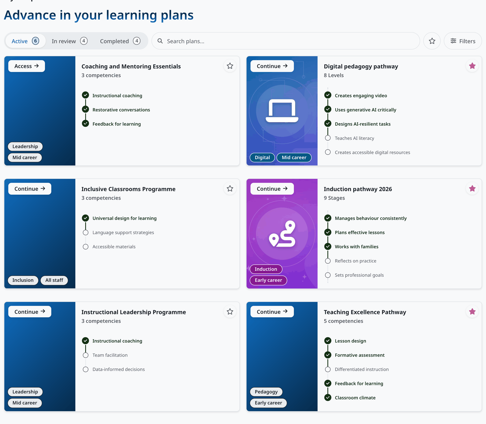

Templates set (in `local_dimensions`) to the *plan* display mode render as one card per plan: cover
image or colour identity, tag chips, the competency count with the template's own label ("8
Levels", "9 Stages"), and an **Access** button that reads **Continue** once the plan is under way.
Each card carries a **trail**: a five-step window centred on the last completed competency, with an
indicator when more steps lie before or after it. Trail steps can be links; opening one first arms
`local_dimensions`' *Return to plan* button, so the learner can come back from the course.

Cards come in a vertical or a horizontal layout (`plancard_layout`). The pictures show the
horizontal one, which gives the trail a column of its own.

Competency cards
----------------

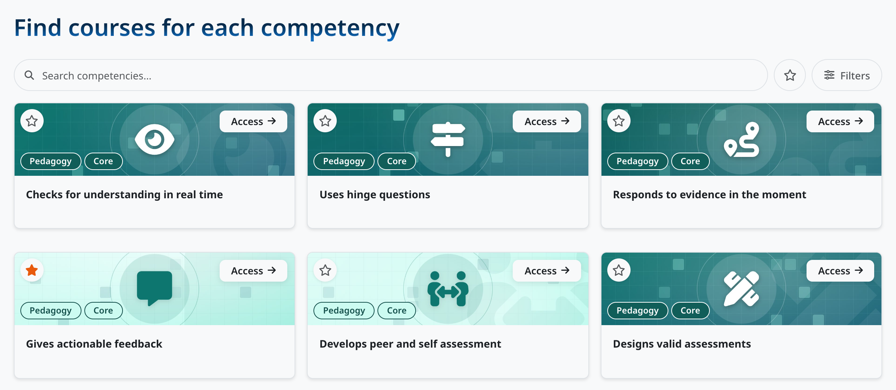

Templates in the *competencies* display mode expand into one card per competency, showing only
competencies linked to at least one visible course, and once even when several plans share them.
Each card opens the competency in `local_dimensions`' learner views.

Status scope
------------

Plans do not stop existing when they are finished. The plans section groups them in three
buckets, **Active**, **In review** and **Completed**, as the scope of its filter line. Only the
opening bucket is loaded with the page; the others are fetched the first time the learner picks
them, and kept. A bucket with no plans is not drawn.

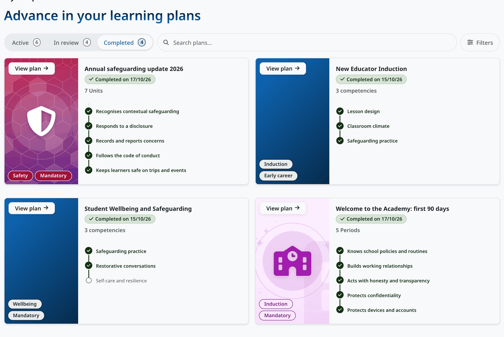

A completed plan shows the ratings Moodle froze when it was completed, not the learner's current
ones, so the card always agrees with core's plan page. Plans waiting for review, or under review,
carry their own chip:

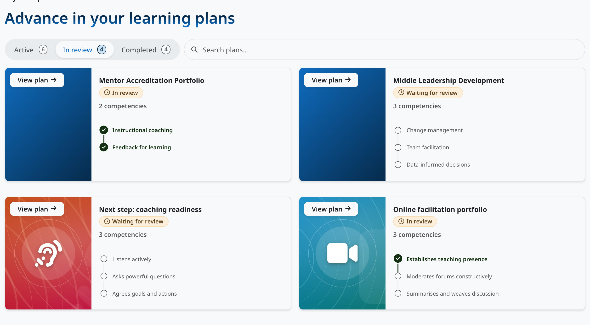

A learner needs `moodle/competency:planviewowndraft` to see their own plan while it is under
review. That is core's rule, not the block's, and no role holds it by default: without it the
*In review* bucket stays empty and its pill is not drawn.

The filter line
---------------

Plans and competencies each get one line under their heading: the status pills (plans only), a
search, a favourites star and **Filters**.

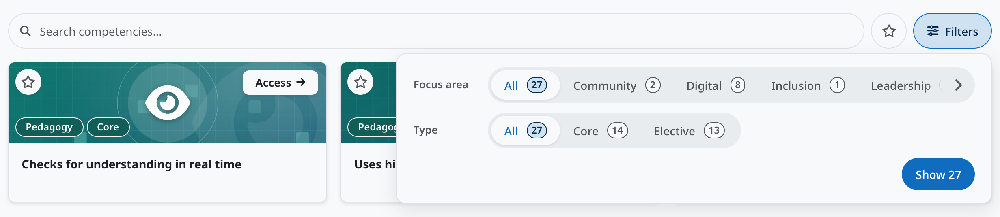

**Filters** opens a panel with the section's tag filters (the custom fields managed in
`local_dimensions`, labelled with their names), a count on every value and *Show N* at its foot. A
filter can be a row of pills or a native dropdown (`*_displaymode`). Each active filter becomes a
chip under the line, with *Clear all* from two chips up, and the button carries a count badge.

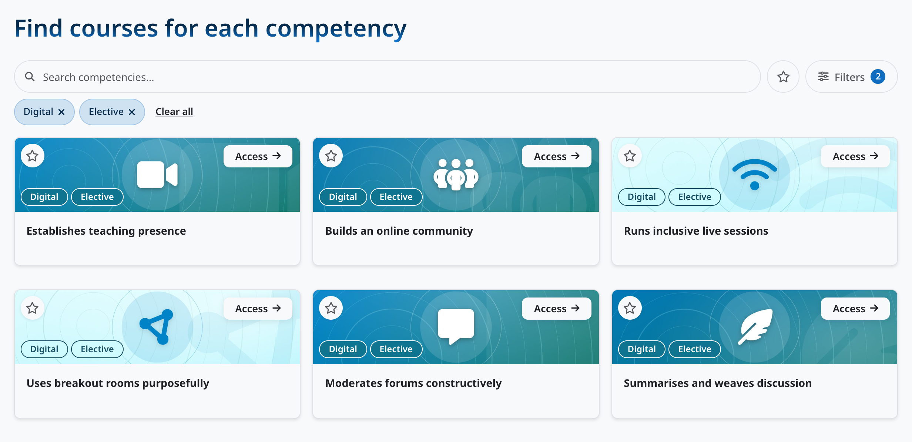

Each section's search reaches only that section's cards, accent- and case-insensitively ("lingua"
finds "língua"), and combines with the filters. Its suggestions list the matching filters first,
with the number of cards each would leave, then the matching cards; `/` opens the search.

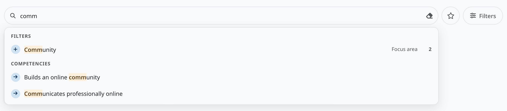

Each line measures its own width and folds: Filters loses its word, the search becomes an icon,
then the line splits in two. From the third step the search grows over the line, with a close
button; at the two-line step the panel is a bottom sheet. So the block works on a wide page, in a
narrow column and on a phone.

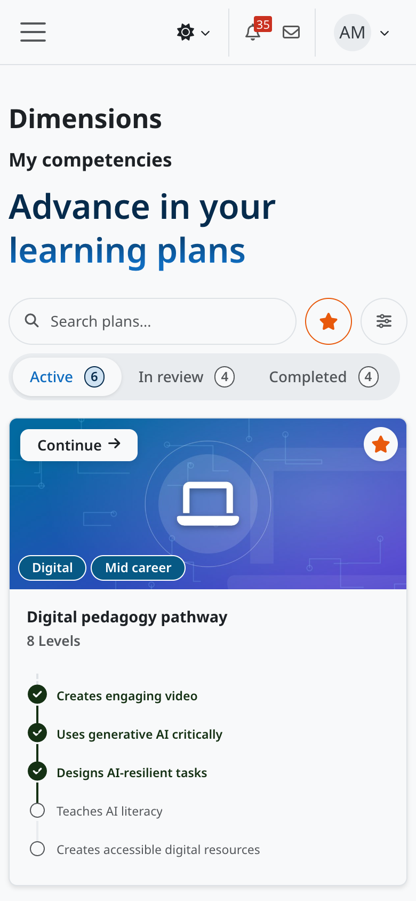
&nbsp;&nbsp;
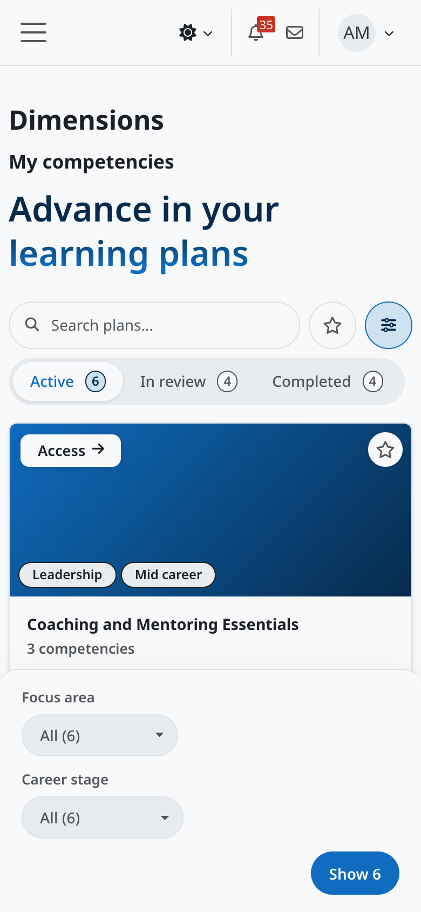
&nbsp;&nbsp;
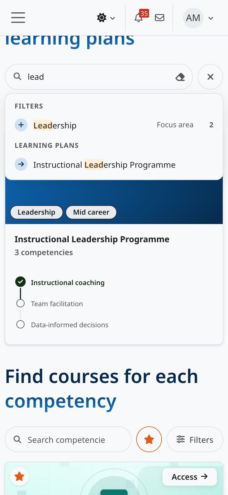

Nothing on the line is remembered between visits.

Favourites
----------

Learners star any card, and favourites drive how the block loads:

- On first paint the block asks for **favourites only**, so the cards a learner cares about render
  at once; a ghost card counts the rest ("View more items (3)") and loads them on demand, as does
  releasing the section's star or typing a search.
- Each section has its own star on its line.
- Favourites are stored through Moodle's **core Favourites subsystem** in the user's own context,
  and the star validates ownership server-side before writing.

Favourites can be switched off with one setting, which removes the stars and the favourites-first
loading together.

Dark mode and the family theme
------------------------------

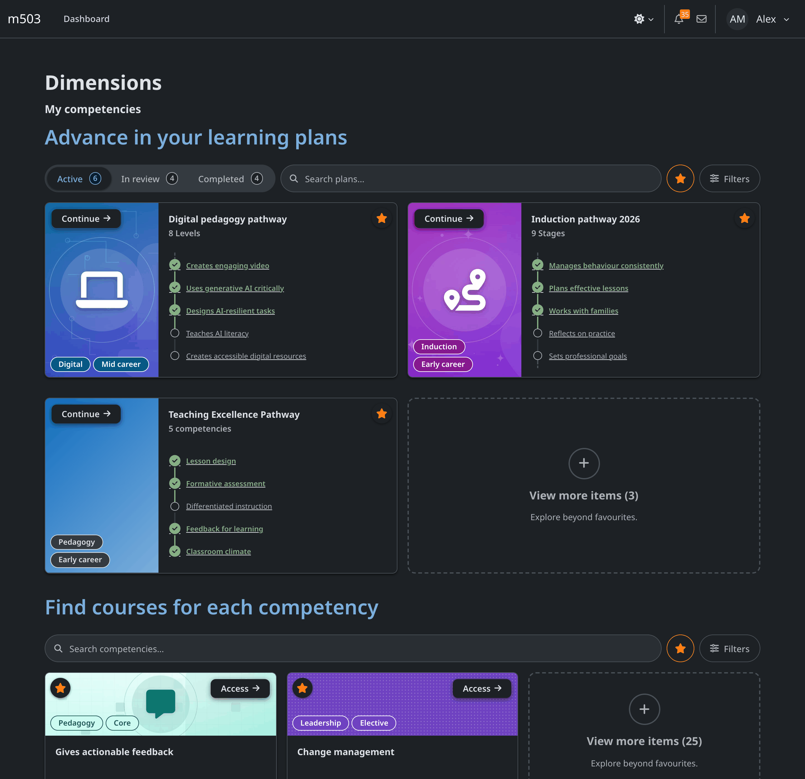

Every colour comes from the theme's tokens, so the block follows Moodle's dark mode; the covers and
colours set on a plan stay as the administrator chose them.

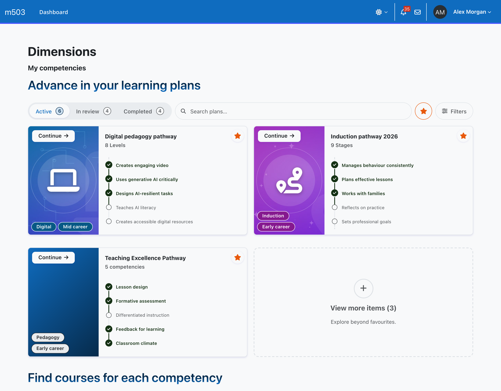

Under `theme_dimensions`, the family's theme, the block reads the theme's family tokens first;
without it nothing changes.

Requirements
------------

One branch per Moodle version, each declaring `$plugin->supported` for exactly that version and
requiring `local_dimensions` from its branch for the same version:

| Branch | Moodle | Version | Release | Requires `local_dimensions` |
|---|---|---|---|---|
| `MOODLE_405_STABLE` | 4.5 LTS | 2024100700 | v4.5-r1 | 2024100700 |
| `MOODLE_501_STABLE` | 5.1 | 2025100600 | v5.1-r1 | 2025100600 |
| `MOODLE_502_STABLE` | 5.2 | 2026042000 | v5.2-r1 | 2026042000 |
| `main` (= `MOODLE_503_STABLE`) | 5.3 | 2026100504 | v5.3-r1 | 2026100500 |

The 5.3 line (`main`) takes new work first and uses PHP 8.3 syntax; this README and its pictures
describe `main` on Moodle 5.3. Moodle 5.0 has no branch.

- Core competencies enabled (`core_competency`, with `tool_lp`).
- [local_dimensions](https://github.com/uaiblaine/moodle-local_dimensions), from the branch for your
  Moodle version: the block reads all card metadata through its caches.

Installation
------------

Install the plugin like any other plugin to folder `/blocks/dimensions`, from the branch for your
Moodle version, after `local_dimensions`. See
[Installing plugins](https://docs.moodle.org/en/Installing_plugins).

**Switching a site from a date-numbered release**: replace the files of both plugins with the
branch for the site's Moodle, then
`php admin/cli/cfg.php --component=block_dimensions --name=version --set=2026100499` and the same
for `local_dimensions`, then `php admin/cli/upgrade.php`. Without the version reset Moodle refuses
the new files as a downgrade. The block has no upgrade steps.

The block works without configuration: add the "Dimensions" block to the Dashboard (or any page
that accepts blocks) and it renders cards from the user's learning plans. It shows only for a
learner holding a plan it can show.

Settings
--------

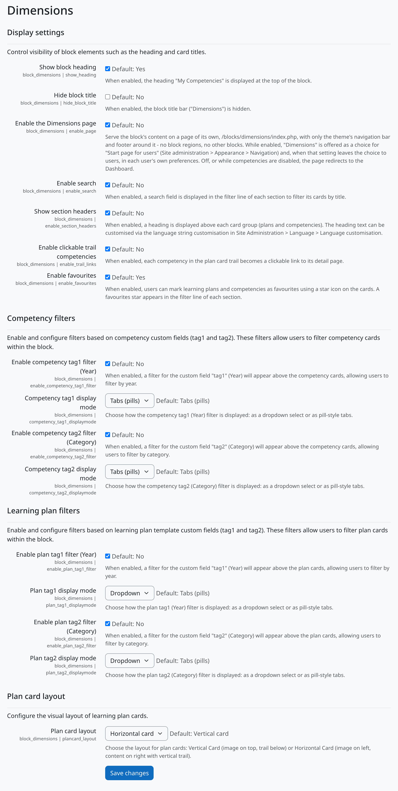

All settings live under *Site administration > Plugins > Blocks > Dimensions*:

- **Appearance**: show the "My competencies" heading (`show_heading`), hide the block title bar
  (`hide_block_title`), show a heading above each card group (`enable_section_headers`), and choose
  the plan card layout (`plancard_layout`, vertical or horizontal).
- **Search**: a search field in each section's filter line (`enable_search`).
- **Filters**: enable each of the four tag filters independently (`enable_plan_tag1_filter`,
  `enable_plan_tag2_filter`, `enable_competency_tag1_filter`, `enable_competency_tag2_filter`) and
  choose how each one shows in the Filters panel (`*_displaymode`, pills or dropdown).
- **Favourites**: the stars and the favourites-first loading (`enable_favourites`, on by default).
- **Trail**: trail steps as links with the return-to-plan integration (`enable_trail_links`).
- **Own page**: the block's content on a page of its own (`enable_page`, off by default).

### The Dimensions page and the start page

With `enable_page` on, `/blocks/dimensions/index.php` shows the block's content and nothing else:
the theme's navigation bar, the page heading ("Dimensions") and the footer around it, on the `base`
layout, so no block drawer, no other blocks and no "Add a block" in editing mode. Every logged-in
user other than a guest can open it, and a guest is sent to the site home; the cards are the
viewer's own, and a learner without a plan sees the "no active plans" notice instead of an empty
page. The first picture of this README is that page.

While the page is enabled, **"Dimensions" is offered as a choice for *Start page for users***
(*Site administration > Appearance > Navigation*), through core's `extend_default_homepage` hook.
Chosen there, the site root and every login land on the page; when that setting is *User
preference*, each user finds "Dimensions" among their own start page choices. The Dashboard stays
reachable at `/my/`.

Off (the default, so an upgrade changes nothing), or while core competencies are disabled, the
option is withdrawn and the page redirects to the Dashboard, so a start page stored earlier still
lands somewhere.

Built for performance
---------------------

- **The server ships a shell, the browser renders the cards**: the page carries only labels and
  configuration; one AJAX web service returns the dataset and cards are rendered client-side from
  Mustache templates.
- **Loaded in phases**: favourites first, the rest of a section and the other status buckets only
  when the learner asks for them.
- **Cache-backed metadata**: every image, colour and tag comes from `local_dimensions`' MUC caches;
  the block performs no per-card custom field or file queries.
- **Incremental rendering**: cards enter the DOM in batches of 24 per animation frame, and a newer
  render cancels a stale one.
- **Filtering never re-renders**: search and filters toggle the visibility of cards already drawn.
- **No session lock**: the dataset service declares `readonlysession`, so on a site that enables
  read-only sessions the block's loads no longer wait for the page's other requests.

Capabilities
------------

- `block/dimensions:addinstance`: add a Dimensions block to a page. Default: manager.
- `block/dimensions:myaddinstance`: add a Dimensions block to one's own Dashboard. Default:
  authenticated user.

Web services
------------

Three AJAX-only external functions back the block (all require login, reject guests and validate
the user context):

- `block_dimensions_get_block_dataset`: the card dataset; supports favourites-only loading,
  per-section loading and one plan status bucket at a time, plus the counts every pill needs.
- `block_dimensions_toggle_favourite`: stars or unstars a plan or competency after validating
  ownership.
- `block_dimensions_set_return_context`: arms `local_dimensions`' *Return to plan* button before
  trail navigation.

Accessibility
-------------

The block aims at WCAG 2.1 AA:

- Cards use the stretched-link pattern: one real link per card, no nested interactive elements;
  stars are native buttons with `aria-pressed`.
- Status pills and filter pills are radio groups with roving tabindex and full keyboard support
  (arrows, Home/End); every control has an accessible name, and the line's controls are 44px.
- Live regions announce result counts, loading, empty states and favourite errors.
- Trail completion is conveyed in text for screen readers, not by colour alone; decorative imagery
  is hidden from assistive technology.
- `prefers-reduced-motion`, `prefers-contrast: more` and print styles are honoured.

Theme support
-------------

This plugin is developed and tested on Moodle core's Boost theme and should work with Boost child
themes. Under `theme_dimensions` it reads the family tokens first. We can't support any other theme.

Companion plugin
----------------

**Competency Dimensions** (`local_dimensions`) is required and does the heavy lifting: it manages
the custom fields that give plans and competencies their visual identity, owns the caches this
block reads, renders the learner views the cards link into, and hosts the *Return to plan* button
the trail links arm. Its own README shows the Competency hub where all of it is managed.

Repository: https://github.com/uaiblaine/moodle-local_dimensions

Plugin repositories
-------------------

This plugin is published in the Moodle plugins repository:
https://moodle.org/plugins/block_dimensions

The latest development version can be found on GitHub:
https://github.com/uaiblaine/moodle-block_dimensions

Bug and problem reports / Support requests
------------------------------------------

This plugin is carefully developed and thoroughly tested, but bugs and problems can always appear.

Please report bugs and problems on GitHub:
https://github.com/uaiblaine/moodle-block_dimensions/issues

We will do our best to solve your problems, but please note that due to limited resources we can't
always provide per-case support.

Feature proposals
-----------------

Please issue feature proposals on GitHub:
https://github.com/uaiblaine/moodle-block_dimensions/issues

Please create pull requests on GitHub:
https://github.com/uaiblaine/moodle-block_dimensions/pulls

Translating this plugin
-----------------------

This Moodle plugin is shipped with English and Brazilian Portuguese language packs. All
translations into other languages must be managed through AMOS (https://lang.moodle.org) by what
they will become part of Moodle's official language pack.

Right-to-left support
---------------------

This plugin has not been tested with Moodle's support for right-to-left (RTL) languages.
If you want to use this plugin with an RTL language and it doesn't work as-is, you are free to send
us a pull request on GitHub with modifications.

Privacy
-------

The block stores one kind of personal data: **favourites**. When a user stars a card, a row is
written through Moodle's core Favourites subsystem into the `favourite` table (component
`block_dimensions`, item type `plan` or `competency`), always in that user's own user context.

The plugin implements the Moodle Privacy API in full: favourites are exported on data-subject
requests under the block's name, and removed by every core deletion path (single user, selected
users, whole context). Uninstalling the plugin purges all of its favourite rows; core's uninstall
routine does not do this by itself, so the plugin ships its own cleanup.

Everything else is presentation: the card dataset is computed per request from core competency
data and `local_dimensions` caches, and the optional return-to-plan context lives only in the
user's session cache. The block creates no database tables of its own.

Scheduled tasks
---------------

This plugin adds no scheduled tasks and queues no background (ad-hoc) tasks.

Maintainers
-----------

The plugin is maintained by\
Anderson Blaine

Copyright
---------

The copyright of this plugin is held by\
Anderson Blaine

Individual copyrights of individual developers are tracked in PHPDoc comments and Git commits.
